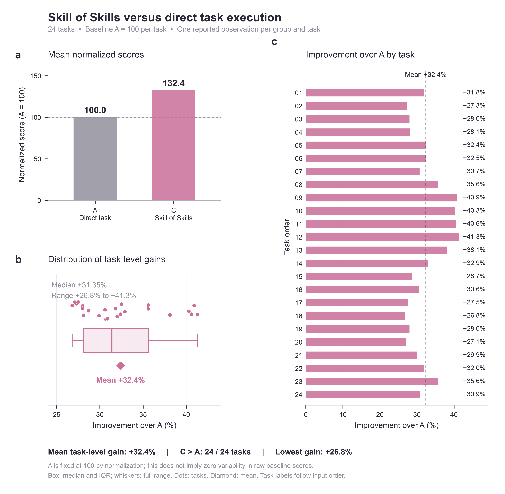

# Skill of Skills

不知道怎么跟 Agent 聊天？听说 Skill 很强，却不知道该用哪个？你可能需要 SoS(Skill of Skills)！

把你要干什么告诉Skill of Skills吧！

不用想方设法构建复杂的提示词，也不用纠结琳琅满目的专业技能怎么选、选哪个，一句话感受agent的魅力！

- “老板让我分析一下这个季度的经营情况，材料都在这儿，用 Skill of Skills 帮我。”
- “下周要汇报了，帮我把这份申报书讲清楚，只有十分钟。”
- “三家供应商的方案看得我头大，帮我理理怎么选。”

接下来，让它把活儿安排明白。

🔍 先看材料，再找专业帮手。

分析数据、整理报告、制作演示文稿……它会挑选适合这项工作的专业技能；现有能力不够，还会寻找外部技能，告诉你值得装哪个、为什么。

🧩 把一句需求，拆成看得懂的具体方案。

哪些问题值得分析？哪些材料还缺？先做什么、后做什么？最后交什么、怎么检查？提前摊开给你看。

✏️ 方案直接改，工作由你定。

页面里点点铅笔就能修改。不需要 PPT？删掉。想多分析一个问题？加进去。保存后，回到聊天说一句：“按方案执行。”

🚀 专业技能接着干，做完还要检查。

按修改后的方案推进，核对成果，发现偏差及时调整，让任务朝着你要的结果走。

带上你的任务，来跟 Skill of Skills 聊聊看看吧！

## 安装与使用

从 [Release](https://github.com/hzy24/skill-of-skills/releases/) 下载 `.skill` 文件，在技能管理中上传并启用。

用日常语言提出任务；审阅、修改方案并保存后，回复“按方案执行”。

HTML 保存需要宿主支持运行随包保存服务并访问其地址；技能目前面向第一届数智公司“元景杯”数字员工技能创新大赛开发，在元景数字员工上实现，具体HTML集成方式见 [元景保存说明](references/yuanjing.md)。

## Benchmark：24 题 ABC 对照测试

基于 InsightEval，随机抽取 4 轮、每轮 6 道不同题目，比较直接交办、匹配专业技能与 Skill of Skills。每题以直接交办得分归一化为 100。

| 组别 | 平均逐题得分提升 | 汇总耗时增加 |
|---|---:|---:|
| A · 直接交办 | 基线 | 基线 |
| B · 匹配专业技能 | +29.8% | +24.8% |
| C · Skill of Skills | **+32.4%** | +42.9% |

SoS 在全部 24 道题上高于直接交办，在 15 道题上高于匹配专业技能组。评分采用 ROUGE Insight F1。

[完整测试说明、逐题数据与复现脚本](docs/benchmarks/insighteval-24/README.md)

## 第三方来源

所引用的专业方法、版本和许可证见 [THIRD_PARTY_NOTICES.md](THIRD_PARTY_NOTICES.md)。
