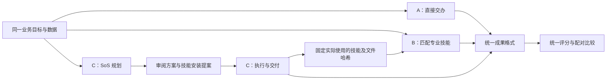
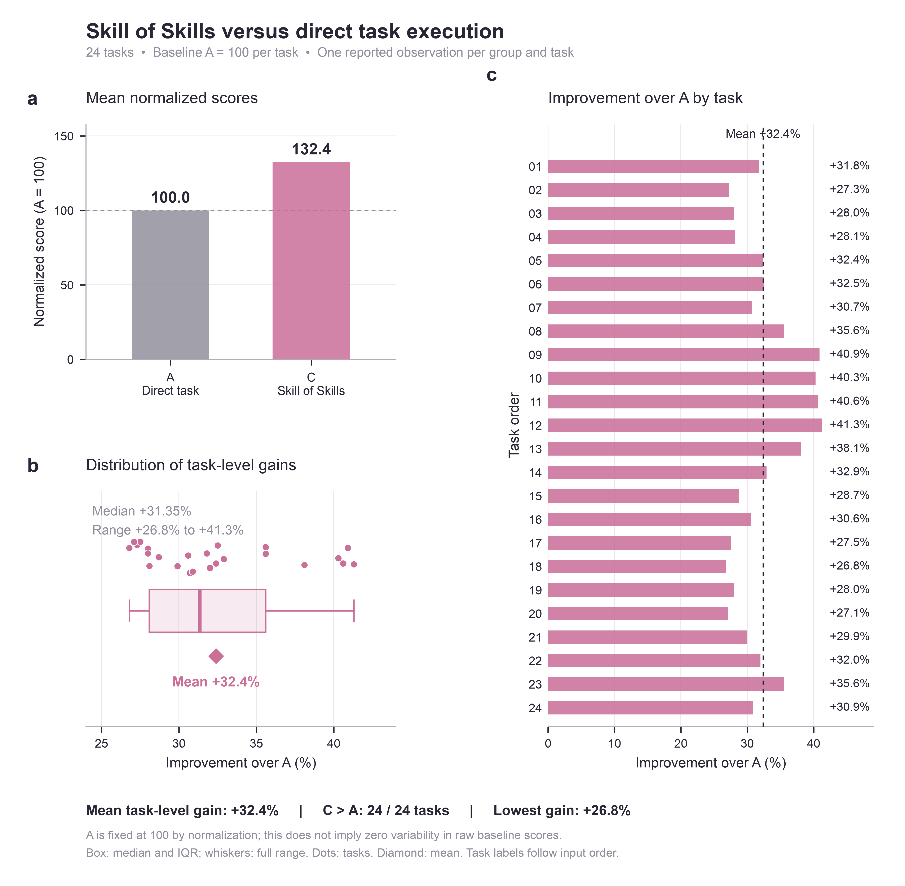
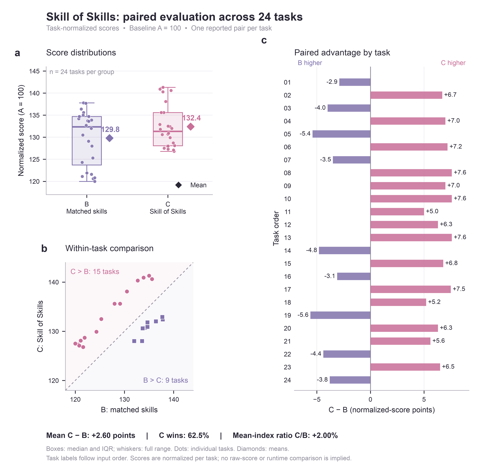

# Skill of Skills：24 题 Benchmark 对照测试

## 一句日常需求，能从SoS中获得多少收益？

本次使用 InsightEval 开展 24 道题的 ABC 对照测试，比较直接交办、匹配专业技能、使用 Skill of Skills 三种工作方式。以每道题的直接交办得分为基线，Skill of Skills 的**平均逐题得分提升为 32.4%**，24 道题均获得正向提升；与匹配专业技能组相比，平均指数高 **2.60 点**，在 **15 道题**上取得更高得分。

### 实验组设置

**A 组：直接交办**

用户直接提交业务需求与数据，由 Agent 自主理解任务、确定分析步骤、开展计算并生成成果。该组可以使用原生文件读取、代码执行、内置技能、基础计算工具等一切原生能力。A 组作为基线，代表用户直接向 Agent 交办任务的工作方式。

**B 组：匹配专业技能**

在相同业务需求与数据基础上，为 Agent 配置与 C 组实际使用情况相匹配的专业技能及交付技能。技能文件版本保持一致，Agent 根据这些技能提供的方法，自主安排分析步骤并完成任务。B 组不使用 SoS，也不接收 C 组的任务方案、计算结果或分析结论。该组代表“当专业技能已经选好，由 Agent 自行组织工作”的方式，用于观察专业技能本身带来的收益。

**C 组：Skill of Skills**

用户提交业务需求与数据，由 SoS 识别任务类型和交付要求，检索、筛选适合的专业能力，再结合技能方法拆解业务阶段，明确各阶段的职责、输入输出、依赖关系和交付要求。SoS 先生成可审阅、可修改的方案，经确认及具体安装授权后，组织专业技能执行，并核对实际技能调用与交付是否符合方案。该组评价 SoS 从能力选择、任务规划到执行组织的完整工作流。

**三组对照的含义：** A 与 B 比较匹配专业技能后的变化；A 与 C 比较引入 SoS 完整工作流后的变化；B 与 C 在匹配技能的条件下，进一步观察任务规划与执行组织方式带来的差异。实验中先完成 C，再依据其实际技能使用记录配置 B，保留技能文件哈希和调用证据，确保匹配关系可追溯。

| 组别 | 工作方式 | 核心安排 |
|---|---|---|
| A · 直接交办 | 直接提交业务目标与数据 | 使用普通原生工具完成任务 |
| B · 匹配专业技能 | 业务目标与数据，加上匹配的专业技能 | 使用 C 实际使用的同版本技能，自行组织步骤 |
| C · Skill of Skills | 业务目标与数据，由 SoS 组织完成 | 检索与选择能力、生成方案、确认后执行并交付 |

实验流程先运行 C，再依据 C 的实际技能读取与调用记录准备 B。B 获取冻结的技能文件与方法入口，任务方案、计算结果和分析结论保留在 C 的独立会话中。每题每组使用独立会话；业务输入、模型配置和成果格式保持一致。




以下为结果总表：

| 组别 | 平均得分指数 | 平均逐题得分提升 | 汇总耗时指数 | 汇总耗时增加 |
|---|---:|---:|---:|---:|
| A | 100.0 | 基线 | 100.0 | 基线 |
| B | 129.8 | +29.8% | 124.8 | +24.8% |
| C | **132.4** | **+32.4%** | 142.9 | +42.9% |


## 1. 测试关注什么

本次对照围绕三个问题展开：

1. 与直接交办相比，接入专业技能能带来多少得分收益？
2. 与已经匹配专业技能的任务相比，SoS 的规划与执行组织表现如何？
3. 为获得这些结果，需要增加多少时间？

A→B 衡量匹配专业技能后的变化；A→C 衡量使用 SoS 整体流程后的变化；B→C 展示在专业技能匹配条件下，两种组织方式的差异。

我们Proof的是：**Skill of Skills 通过用户的一句话，完成能力检索、技能选择、任务拆解、方案审阅和执行组织，而这些能不能带来实质交付质量的提升呢？**

## 2. Benchmark 与实验配置

### InsightEval

[InsightEval](https://github.com/zhenghaozhu23/InsightEval) 面向表格数据中的业务洞见发现。公开数据集包含 100 个任务、1,000 条参考洞见，覆盖事件管理、资产管理、人员管理、财务管理、目标管理及跨领域业务分析。输入由业务目标与一张或多张数据表组成，输出为分析洞见及总结。


### 实验配置

| 项目 | 设置 |
|---|---|
| 任务抽取 | 从 100 题中无放回随机抽取 24 题 |
| 批次 | 4 轮，每轮 6 道不同题目 |
| 随机种子 | `20261105` |
| 分组 | 每题 A、B、C 三组，各运行一次；设计规模 72 次任务 |
| SoS 版本 | `1.2.0 release`，沿用冻结实验包 |
| 运行平台 | 元景数字员工-Uniwork |
| 模型 | 沿用实验包的 DeepSeek 配置 |
| 评分 | ROUGE-1 最佳匹配下的 Insight Recall、Precision、F1 |
| 主要展示指标 | Insight F1 的逐题归一化指数 |


## 3. 评分与归一化

### 洞见评分

评分器为每条参考洞见寻找最相近的生成洞见，计算 Insight Recall；再为每条生成洞见寻找最相近的参考洞见，计算 Insight Precision。两者的调和平均为 Insight F1。文本相似度采用 ROUGE-1 F1。

本轮采用官方公开代码同口径的本地评分方法。[评分实现](https://github.com/zhenghaozhu23/InsightEval/blob/main/src/insighteval/metrics.py)；实验包另提供调用官方 CLI 独立重算的入口。该指标衡量与参考洞见的词汇匹配程度；业务事实正确性、建议可执行性和新颖性属于独立评价维度。

### 每题 A＝100

设第 i 题三组原始分数为 Aᵢ、Bᵢ、Cᵢ，则：

```text
A 指数ᵢ = 100
B 指数ᵢ = 100 × Bᵢ / Aᵢ
C 指数ᵢ = 100 × Cᵢ / Aᵢ

平均逐题提升 = mean(组别指数ᵢ − 100)%
```

这一口径让每道题在汇总中获得相同权重。A 的原始得分是每题归一化的分母；图中 A 固定为 100，表示相对基准。

例如，C 的平均指数为 132.4，对应平均逐题提升 32.4%。B/C 的平均指数之比为 `132.4 / 129.8`，对应 C 高约 2.00%。逐题先算 `Cᵢ/Bᵢ − 1` 再平均，结果为 **2.14%**。两者分别描述“均值之比”和“比值的均值”。

## 4. 与直接交办相比：平均逐题提升 32.4%



**图 1｜Skill of Skills 与直接交办的对照。** a，平均归一化得分；b，24 题提升幅度的分布；c，每道题相对 A 的得分提升。散点对应任务，箱体表示四分位区间，箱内横线为中位数，须线为完整取值范围，菱形为均值。

| C 相对 A 的表现 | 结果 |
|---|---:|
| 平均逐题提升 | **+32.40%** |
| 提升中位数 | +31.35% |
| 最小提升 | +26.8% |
| 最大提升 | +41.3% |
| 获得正向提升的题目 | **24 / 24** |

这组结果中，SoS 的正向收益覆盖全部 24 道题。提升幅度从 26.8% 到 41.3%，平均水平与中位数接近，展示了任务间收益的分布。

## 5. 与匹配专业技能相比：15 题领先，平均指数高 2.60 点



**图 2｜Skill of Skills 与匹配专业技能组的配对比较。** a，两组得分分布，散点保留所有任务；b，同题 B/C 对照，虚线表示相同得分；c，逐题 C−B 差值，粉色表示 C 更高，紫色表示 B 更高。

| 指标 | B · 匹配专业技能 | C · Skill of Skills |
|---|---:|---:|
| 平均指数 | 129.80 | **132.40** |
| 中位数 | **132.35** | 131.35 |
| 样本标准差 | 6.18 | 4.80 |
| 最小值 | 120.0 | 126.8 |
| 最大值 | 137.8 | 141.3 |
| 同题得分更高的次数 | 9 | **15** |

C 在 15/24 题上领先，占 **62.5%**；B 在其余 9 题上领先。C−B 平均差为 **+2.60 个指数点**，配对差中位数为 **+5.95 点**，取值范围为 **−5.60 至 +7.60 点**。

C 的均值更高、任务间标准差更小；B 的中位数更高。这些统计量共同呈现两组分布的形态。这里的标准差描述不同任务之间的归一化得分波动；重复运行的稳定性需要同题多次运行数据。

## 6. 时间投入

| 比较 | 得分变化 | 耗时变化 |
|---|---:|---:|
| B 相对 A | 平均逐题 +29.8% | 汇总耗时 +24.8% |
| C 相对 A | 平均逐题 +32.4% | 汇总耗时 +42.9% |
| C 相对 B | 平均指数之比 +2.00% | 汇总耗时之比 +14.50% |

耗时比较依据测试方回传的相对 A 汇总增幅。C/B 的时间差由 `142.9 / 124.8 − 1` 计算。

SoS 在本轮获得最高平均得分，并投入更多运行时间。产品使用时，可以结合任务的重要程度、交付质量要求和可用时间，选择直接交办、匹配专业技能或 SoS 完整工作流。


## 7. 结果解读


**SoS 获得最高平均指数。** C 相对 A 的平均逐题提升为 32.4%，并在 15 道题上超过 B，体现了能力选择与任务组织相结合的产品方向。

**专业技能的选用带来明显收益。** B 相对 A 的平均逐题提升为 29.8%，说明在这批任务中，为任务匹配专业方法是有效的质量提升环节。而 B 选用的技能其实来自 C 的检索，这说明了 SoS 能为用户到合适的专业技能并提高交付质量。

**质量收益伴随额外运行时间。** C 比 B 的平均指数高约 2.00%，汇总耗时增加约 14.50%。尽管考虑到 C 的耗时包括搜索和安装Skill，但是后续迭代仍可围绕规划开销、能力匹配精度和执行衔接持续改进。

结果体现了一个有价值的方向：很多用户有明确的工作需求，却不熟悉提示词，也不知道该选哪个技能、怎样把专业能力用到自己的任务上，而Skill of Skills 有望补上这段距离：用户用日常语言说清要做什么，SoS 帮助寻找合适的能力、组织可审阅的方案，并推动任务交付。

> [!TIP]
> 让每一位用户从一句日常需求出发，**轻松找到并用好专业技能**，把普通的任务交办变成看得见的高质量交付；让 Agent 更容易上手、更值得分享，逐步走进更多人的日常工作。

## 9. 数据与测试材料

| 文件 | 内容 |
|---|---|
| [results.csv](results.csv) | 24题归一化结果、配对差及逐题相对变化 |
| [完整评测工具包](benchmark-kit.zip) | 抽样、启动、成果采集、评分脚本 |
| [绘图源码与矢量图](figures-source.zip) | Python源码、数据、图注及PDF/SVG文件 |

测试workflow：按种子抽样benchmark → C规划与确认执行 → 固定C实际技能用于B → 完成ABC → 统一评分与汇总。

### 引用

Zhu et al. **InsightEval: An Expert-Curated Benchmark for Assessing Insight Discovery in LLM-Driven Data Agents.** Findings of ACL 2026. [论文](https://aclanthology.org/2026.findings-acl.1729/) · [项目与评分代码](https://github.com/zhenghaozhu23/InsightEval)
